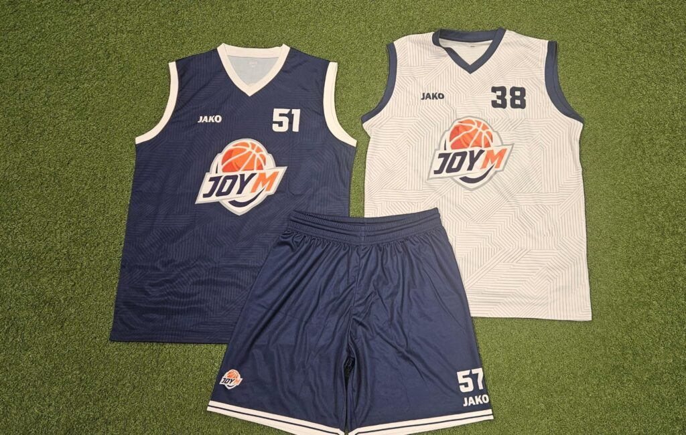

Joy-M speelt in kleding van **JAKO**. In onze eigen teamshop vind je alle clubkleding met het Joy-M logo bij elkaar: voor op het veld, bij de training en daarbuiten. Je bestelt en betaalt rechtstreeks bij JAKO.

## Wat vind je in de shop?

- **Basketbalkleding:** shirt en short *Center 2.0*, en de reversible shirt en short *Change 2.0* (twee kleuren in één, handig bij trainingen).
- **Power-lijn:** shirt met korte mouwen, short, jas met kap en vrijetijdsbroek.
- **Base-lijn:** T-shirt, sweater met kap en joggingshort.
- **Accessoires:** zoals een drinkfles en badslippers.

Het aanbod kan per seizoen veranderen. In de shop zie je altijd het actuele assortiment en de prijzen.

## Zo bestel je

1. **Open de teamshop** via de knop op deze pagina.
2. **Kies je product en maat.** De meeste kleding is er in maten voor kinderen, unisex en dames. Twijfel je over de maat? Vraag je trainer of je even een teamgenoot mag passen.
3. **Rond je bestelling af** bij JAKO. Bij sommige artikelen zie je bij de maat wanneer ze beschikbaar zijn; houd daar rekening mee als je iets voor een bepaalde datum nodig hebt.

Vragen over de clubkleding? Mail ons via [joymbasketbal@gmail.com](mailto:joymbasketbal@gmail.com).
