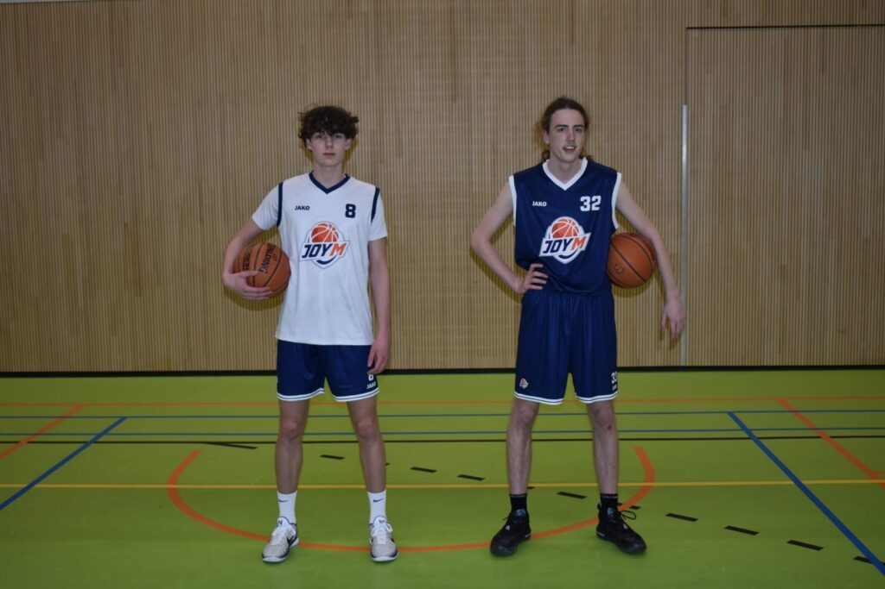
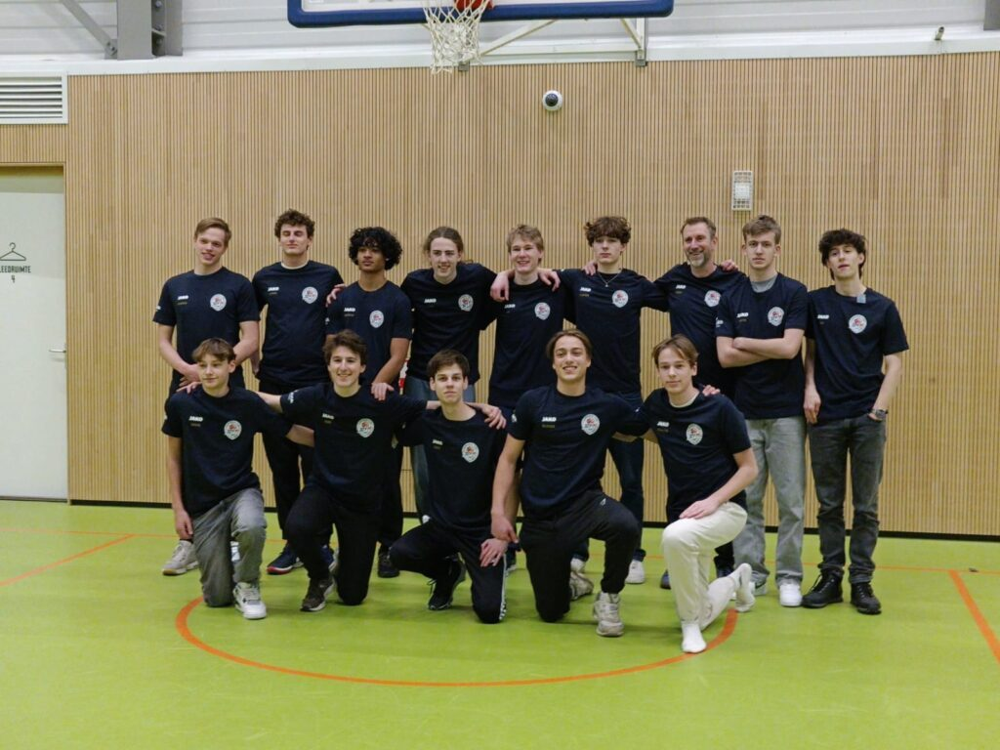
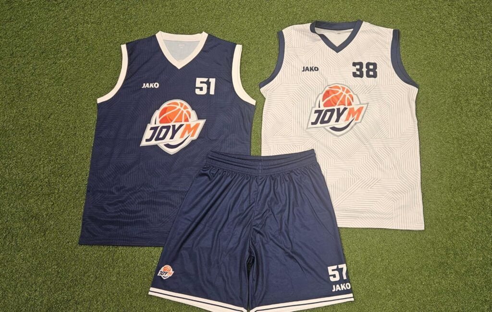

De competities zijn afgelopen en ook de laatste trainingen zitten erop. Een mooi moment om eens terug te kijken op het afgelopen seizoen!

## Competitieteams

### Heren senioren
De heren hebben een mooi seizoen achter de rug waarin ze uiteindelijk op een zeer verdienstelijke **3e plek** zijn geëindigd in de competitie. Het beste resultaat in jaren! Deze prestatie kwam mede tot stand door het verder invoegen van enkele U18-spelers. Hierdoor ontstond een mooie mix van ervaring en jeugdig enthousiasme.

### U18
De U18 speelde een competitie in twee delen. Het eerste deel werd de U18 **glansrijk kampioen**! Een prestatie om trots op te zijn. Na de kerst volgde het tweede competitiedeel, waarin de overwinningen wat lastiger waren, maar de wedstrijden wel spannender en van een hoger niveau werden. Kortom: een heuglijk seizoen!

### U16
De U16 bleef het hele jaar stabiel presteren. Zowel voor als na de kerst draaide het team continu mee in de bovenste regionen van de competitie. Mooi om te vermelden is dat ze meerdere wedstrijden met 1, 2 of slechts 3 punten verschil hebben gewonnen! Al deze close games werden winnend afgesloten. Mooie fighting spirit dus!

### U14
De U14 startte met een team dat op één speler na alleen maar spelers had zonder competitie-ervaring. Alles was nieuw en wennen, waardoor een overwinning vinden moeilijk was. Ondanks dit heeft het team tot het einde toe zijn best gedaan. Al met al een leerzaam seizoen!

## Recreatieve teams

Naast deze competitiespelende teams waren er ook nog vier recreatieve teams.

### U12
Onze jongste groep spelers is gedurende het seizoen steeds groter geworden. Met veel plezier zijn de eerste stappen gezet om het basketbalspelletje onder de knie te krijgen! Het verschil in vaardigheden tussen het begin en het eind van het seizoen is echt enorm!

### Dames recreanten
Sinds enkele jaren is er een herstart met een volledig damesteam, en dat verloopt zeer succesvol. Er is veel plezier en inzet bij elke training, met een stabiele groep dames die wekelijks met veel enthousiasme komt.

### Recreanten gemengd
Op dinsdagavond is er ook een groeiende groep recreanten die elke week met veel plezier een balletje komt gooien. Zowel ervaren spelers als beginnende volwassenen hebben het afgelopen jaar ontspannen gespeeld.

### Walking basketbal
Het hele jaar door is er op vrijdag een stabiele groep geweest bij het walking basketbal. Naast het oefenen van basisvaardigheden werden er elke week met plezier partijtjes gespeeld in gemengde teams.

## Nieuw logo en nieuwe tenues

Ook hebben we dit jaar ons nieuwe logo en onze nieuwe tenues in gebruik genomen. In één woord: **PRACHTIG!**

Verder was het een zeer geslaagd seizoen met drukbezochte clubactiviteiten zoals het oliebollentoernooi en het family & friends toernooi.

Op naar volgend seizoen!
